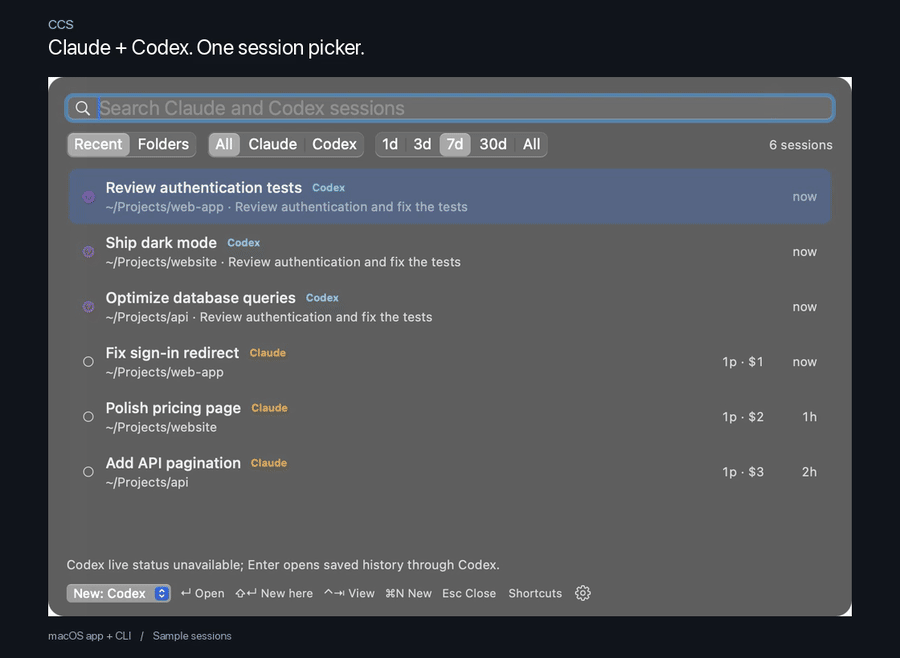

# CCS

A native macOS popup and terminal picker for Claude Code and Codex. Search saved
sessions, focus an existing Terminal tab, resume a closed conversation, or start
clean in a project or a new dated folder.

CCS requires macOS 14 or later, Terminal.app, and at least one installed command:
`claude` or `codex`.
The Swift app and CLI share one engine. Neither Python nor Hammerspoon is needed.



A 14-second walkthrough using sample sessions. [Watch the MP4](docs/media/ccs-demo.mp4).

## Install

Download the [signed, notarized universal DMG](https://github.com/alexamber/ccs/releases/download/v1.0.1/CCS-1.0.1-macos-universal.dmg),
drag CCS into Applications, and open it. Choose **Install Command-Line Tool** in
the CCS menu to install the terminal picker too. Both Apple Silicon and Intel
executables are included.

Or install both the app and CLI with Homebrew:

```sh
brew tap alexamber/ccs https://github.com/alexamber/ccs.git
brew install --cask alexamber/ccs/ccs
```

If the old formula is installed, uninstall it with
`brew uninstall --formula alexamber/ccs/ccs` before installing the cask.

To build from this checkout, with Xcode 15 or newer installed:

```sh
bash scripts/build-app.sh --development
bash scripts/install-native.sh
open ~/Applications/CCS.app
```

This builds a universal Apple Silicon/Intel app plus a DMG and ZIP in `dist/`.
Development artifacts are ad-hoc signed and are not notarized public downloads.
The local installer installs `~/Applications/CCS.app` and links `~/.local/bin/ccs`.
It backs up an existing app and command before replacing them. If needed, add
`export PATH="$HOME/.local/bin:$PATH"` to `~/.zshrc`.

## Use

Press **Option-Space** to open the native picker. Type to search, use the arrow
keys to select, and press Enter to focus, attach, or resume a session. Click to
select a row or double-click to open it.

| Shortcut | Action |
| --- | --- |
| Option-Space while open, or Cmd-N | New dated session using the remembered provider |
| Cmd-Shift-N | Choose the provider for new sessions |
| Cmd-1 / Cmd-2 / Cmd-3 | All / Claude / Codex filter |
| Shift-Enter | Start clean using the selected row’s provider and folder |
| Tab / Shift-Tab | Move between controls |
| Control-Tab | Toggle Recent / Folders |
| Cmd-Left / Cmd-Right | Change the date range |
| Cmd-R | Refresh |
| Escape | Close, or cancel the large-session dialog |
| Cmd-comma | Settings |
| Cmd-/ or Shortcuts | Show all picker shortcuts |

The popup opens on the screen containing the pointer, follows system appearance,
and refreshes every five seconds while visible. Click outside or press Escape to
dismiss the picker or menu. CCS stays in the menu bar;
launch at login is optional and off by default. Quit CCS to release its shortcut.
If Hammerspoon still has the old CCS shortcut, remove its `require("ccs").start()`
line and reload Hammerspoon, or choose another shortcut in CCS Settings.

macOS requests Automation permission when CCS first controls Terminal. Allow it
in System Settings → Privacy & Security → Automation. Browsing does not require
Terminal automation. Missing commands are reported before creating a dated folder.
Claude resume is disabled when its live status cannot be verified.

## Choose providers

On first launch CCS detects commands on your shell PATH. A Codex-only installation
starts in Codex mode; a Claude-only installation starts in Claude mode. With both
installed, both are enabled. Settings → **Providers** lets you enable Claude,
Codex, or both. Explicit choices are saved and are not changed when another tool
is installed later. Restart CCS after changing shell PATH.

With one provider enabled, the provider filter is hidden and new sessions use
that provider. With both enabled, the picker has an **All / Claude / Codex**
filter and a **New: Claude / Codex** selector. Filtering the list does not change
the new-session provider. The selector and Settings → **New sessions** share the
same preference. Shift-Enter always uses the selected row’s provider.

Two distinct Option-Space presses register immediately, including rapid taps.
Holding the shortcut suppresses auto-repeat. Further presses are ignored while a
new-session launch is already pending.

Codex history uses the local app-server metadata API. Main CLI/editor/app-server
conversations appear; archived chats and subagents are hidden. Search covers the
title, folder and opening prompt. Unknown prompt counts and dollar totals are
omitted. Integration was verified with Codex CLI 0.167.0.

When available, CCS reads live status from the existing local Codex daemon. If it
can only read saved metadata, rows show unknown live status. Enter focuses an
exactly identifiable `codex resume ID` Terminal tab, or opens that conversation
through Codex CLI. A new view does not submit a prompt. Codex desktop-window focus
is outside this release. CCS never resumes threads or starts model turns merely
to list history. See the [official app-server documentation](https://learn.chatgpt.com/docs/app-server).

## Terminal CLI

A download includes the CLI inside the app. Choose **Install Command-Line Tool**
in CCS's menu to install it into `~/.local/bin`. Homebrew installations link the
command into Homebrew's `bin` directory.

```sh
ccs                    # terminal folder tree, last 7 days
ccs --recent           # newest first
ccs --days 0           # all saved sessions
ccs --watch            # stay open; refresh every 5 seconds
ccs --watch 10 --recent
ccs --days 30 --list    # plain text
ccs --json             # compatible Claude-only JSON
ccs --provider all --json    # combined JSON with provider and qualified key
ccs --provider codex         # Codex terminal picker
ccs --provider claude --list # one-command override of saved providers
ccs --gui              # show the native popup
ccs --new              # remembered provider, new dated folder
ccs --provider codex --new   # one Codex launch; keeps your app preferences
ccs --activate ID      # focus, attach, or resume
ccs --activate ID --fresh
ccs --activate codex:ID # provider-qualified ID avoids ambiguity
```

| Terminal key | Action |
| --- | --- |
| Up / Down, Page Up / Page Down, Home / End | Select a session |
| Enter | Focus, attach, or resume |
| Ctrl-O | Start clean in the selected folder |
| Ctrl-T | New dated session with the displayed new-session provider |
| Ctrl-F | Cycle provider filter |
| Ctrl-B | Change the remembered new-session provider |
| Tab | Toggle folders / recent |
| Left / Right | Change date range |
| Type / Backspace / Escape | Search / delete / clear |
| Ctrl-R / Ctrl-C | Refresh / quit |

`--provider` overrides saved providers for terminal queries and launches without
changing app preferences. With `--gui`, it selects the popup’s saved filter; that
provider must be enabled in Settings → Providers. Bare
`--json` keeps its original Claude-only fields, including explicit nulls and no
provider field. Combined JSON adds `provider` and `key` (`codex:ID` / `claude:ID`);
unavailable Codex counts and costs are null. An ID shared by both providers must
be qualified when activating it. Incomplete history exports fail explicitly.

Green means idle, orange means another live status, a hollow circle means saved,
and a question mark means live status is unavailable. For Codex, saved status
describes the connected daemon, not every possible client. Closed Claude sessions with at
least 20 prompts or $20 recorded cost offer **Start clean here** or **Resume**.
Recorded cost is saved metadata, not a subscription bill or a price prediction.
Explicit CLI actions do not show that confirmation dialog.

## New sessions and settings

New sessions use folders such as `~/ccs-sessions/2026-11-08-1`. The counter is
locked across concurrent launches and retains its high-water mark after cleanup.
Choose another base folder in Settings, or override it in your shell:

```sh
export CCS_NEW_DIR=~/mind/ccs
```

Restart CCS after changing shell settings. CCS reads PATH, `CCS_NEW_DIR`, and
`CODEX_HOME` from your login shell at startup. Settings are shared with the CLI in
`~/.config/ccs/settings.json`.

When Claude or Codex exits, the bundled CLI removes the folder only if it is empty, no
saved session names it, and no process is using it. Another launch also checks
abandoned folders older than five minutes. Cleanup keeps symlinks, other folder
names, nonempty folders, saved-session folders, and folders whose safety cannot
be verified. Cleanup checks saved folders from both providers, including archived
Codex chats and subagents, even when hidden from the picker. If a required history
source is unavailable, folders are kept. Cleanup uses a fresh process snapshot;
macOS cannot atomically prevent an unrelated process entering a folder between
that check and removal. Disable cleanup in Settings if you need to retain all folders.

Claude transcripts remain under `~/.claude/projects`; Codex retains its own data
under `CODEX_HOME` (normally `~/.codex`). The Claude metadata cache in
`~/.cache/ccs/index-v1.json` contains titles, recaps, and prompt excerpts, with
private file permissions. It may be deleted to rebuild it. Session data is not
uploaded by CCS.

## Distribution

The alternative source Homebrew formula builds the native app and CLI locally:

```sh
brew tap alexamber/ccs https://github.com/alexamber/ccs.git
brew install --HEAD alexamber/ccs/ccs
```

The source formula requires Xcode. The release cask installs both the app and CLI
from the signed universal DMG without a compiler dependency. Its checksum is
generated from the notarized artifact.

See [release and signing instructions](docs/releasing.md) and the
[architecture guide](docs/architecture.md). CCS uses direct distribution to retain
Terminal integration and process-aware cleanup. There is an optional HTTPS
tip-link slot in the build; no payment page
or paid features are configured.

## Development

```sh
swift test
bash scripts/build-app.sh --development
python3 scripts/check-native.py build/CCS.app/Contents/MacOS/ccs
```

The developer-only smoke script checks the packaged CLI, installation, cleanup
with a real process, and terminal interaction. Python is used only for this test
harness. The retired Python/Hammerspoon implementation and sandbox experiment
are available in Git history.

[MIT license](LICENSE).
